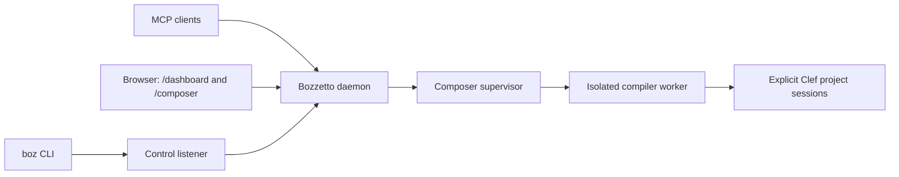

# Bozzetto

**A shared development daemon for the Fidelity Framework.**

People and agents use Bozzetto to edit, build and run a shared Clef project. Clients explicitly open Composer project sessions and reserve edits before changing files. Composer is a differential compiler, so builds recompile only what a change affects. Composer allows execution only if the compiler has accepted the artifact. MCP clients, the browser and command-line tools share sessions under Composer's authority. The browser shows daemon health, leases and the agents at work. The operations journal shows settled non-status Composer operations from all callers, including refusals and bounded run output ([journal owner](Bozzetto/ComposerJournal.fs), [supervisor](Bozzetto/ComposerSupervisor.fs), [page](bozzetto-web/src/Frontend/App.fs)).

[Architecture](docs/architecture.md) · [Composer workflow](docs/composer-workflow.md) · [Operations](docs/operations.md) · [Get started](#get-started) · [Documentation](docs/README.md)

## The Name

A *bozzetto* (Italian, pronounced bot-SET-oh) is the small model a sculptor shapes in clay or wax before starting the full work. The word is the diminutive of *bozzo*, "sketch" or "rough stone" ([Merriam-Webster](https://www.merriam-webster.com/dictionary/bozzetto), [Britannica](https://www.britannica.com/art/bozzetto)). A patron sees the bozzetto and asks for changes while a change still costs little.

The model gives an idea enough substance to be judged: proportion, movement and the relationship between parts become visible before the sculptor commits to the finished material. Bozzetto offers the same exchange between making and examining. A definition or a change is tried against a real project, its consequences are shown as compiler evidence and execution, and it is revised while the work is still open, with people and agents inspecting the same work.

The connection to **Atelier** is deliberate. An *atelier* is an artist's workshop, where sketches, models, tools and unfinished pieces are brought together. Atelier is Fidelity's editing and workbench environment: source beside compiler graphs, proof evidence, execution results and debugging views. Bozzetto is its companion, coordinating the shared compiler workspace and execution behind those views through Composer's contracts. Atelier is the place to arrange, edit and inspect the work; Bozzetto keeps the sessions and execution that people and agents rely on coordinated, so no single interface becomes the owner of compiler meaning.

<a id="-one-daemon-every-client"></a>
<a id="how-bozzetto-works"></a>

## How Bozzetto Works

One long-running daemon owns a single Composer supervisor. Clients connect to that supervisor, which manages an isolated compiler worker containing the live project sessions. The daemon and worker are deployed together, and their PSG contract fingerprints are checked to confirm that they match.



Open a project using its absolute `.fidproj` path, then include the host identity, session identity and compiler epoch in each operation:

| Operation | Meaning |
|---|---|
| Open | Create a Composer project session for an explicit project. |
| Reserve | Withdraw the current artifact's run authority before source or dependency edits. |
| Build | Compile the reserved revision and return diagnostics and artifact evidence, region by region. |
| Run | Have Composer revalidate inputs and executable bytes, then execute the accepted native artifact. |
| Cancel, close or retire | Withdraw authority and report cleanup. Replacing the compiler starts a new worker epoch. |

Composer must revalidate an artifact before execution, regardless of its reported status or path.

### Fidelity.PSG, Fidelity.FSharp.Incremental and Ranvier

- **Fidelity.PSG** provides the compiler's semantic data and the identifiers attached to it. Bozzetto displays this data with its source, target and revision identifiers without adding conclusions the compiler did not provide.
- Bozzetto and the Clef/CCS/Baker/Composer pipeline use **Fidelity.FSharp.Incremental** to track dependencies and explicitly trigger work, including self-hosting work. Bozzetto has no invalidation mechanism of its own, and the data the daemon sends to the browser is derived with this library ([adoption contract](docs/Bozzetto_Incremental_Foundation_Adoption.md)).
- Bozzetto follows **Ranvier**'s update design: data owners publish immutable values, views that depend on those values update, and effects deliver the results. These steps take place within a single mutation domain ([reactive push](docs/reactive-push.md)). Bozzetto uses Ranvier as a design reference without depending on its code.

### Client connections

- **MCP** (Streamable HTTP on port 47749): the `composer_*` tools, the lease tools, the cohort and agent-work tools, and the `composer://sessions` resource. MCP uses JSON-RPC as its standard requires and is Bozzetto's only external protocol with JSON on the wire.
- **The browser** serves `/dashboard` and `/composer` on port 47749 from a single [Partas.Solid](https://github.com/shayanhabibi/Partas.Solid) bundle in [`bozzetto-web/`](bozzetto-web/README.md), connected to the daemon through one WebSocket bridge. When a data owner publishes an update, the daemon sends it to the browser with a stamp and the age of the underlying data, and the page keeps the newest update. Both ends of the bridge use shared data types. The bridge still encodes messages as text. It needs to use BAREWire and typed contracts, as specified for direct communication between the daemon, worker, browser and agents. Apart from MCP, JSON is used only for Fidelity.Data exports and by the separate diagnostic sink process.
- **The control listener** (port 47750): daemon identity and shutdown for `boz status` and `boz stop`. It is a separate listener so that it answers even when the MCP listener has failed.

Callers must hold and renew a lease while building or testing Clef and Composer code. These leases appear on the Composer page beside the compiler worker.

The host and compiler worker run on .NET. Their contracts allow native host and worker processes to replace the .NET processes without making compiler authority depend on CLR types, editors or transport protocols. Bozzetto no longer hosts an embedded F# REPL. Composer is planned to support interactive Clef execution through LLVM ORC JIT, but that backend has not been implemented.

## Roles in Fidelity

| Component | Responsibility |
|---|---|
| Composer / Clef Compiler Service | Source snapshots, semantic and proof authority, compiler evidence, target-specific build and execution admission. |
| Bozzetto | Owns workspaces and sessions, manages worker processes, routes client requests, coordinates leased work, maintains the agent cohort and work board, and reports compiler and daemon state without altering it. |
| Lattice | Language and proof tooling for editors, navigation and linked source/evidence views. |
| Atelier | An editing and workbench environment for the shared workspace, with its own controls and views. |

The [component contracts](docs/Bozzetto_Fidelity_Component_Contracts.md) define each component's responsibilities. The [architecture](docs/architecture.md) describes the daemon and worker, the planned move to native hosting and the requirements for distributed lab nodes.

## Get Started

<a id="installation"></a>

### 1. Install

Bozzetto is built from source and published to the project's Forgejo package registry rather than NuGet.org. The installed `boz` command launches the daemon and its matching Composer worker from the same release directory. To develop the host, use the SDK pinned in `global.json` and follow [the contributing guide](CONTRIBUTING.md) and the [development instructions](docs/development.md). Building the host does not change the compiler distribution used by a session.

### 2. Start the shared daemon

```bash
scripts/start-shared-daemon
```

The helper leaves an existing daemon in place. A new daemon runs from the dedicated workspace `${XDG_DATA_HOME:-$HOME/.local/share}/bozzetto/workspace` and logs to `${XDG_STATE_HOME:-$HOME/.local/state}/bozzetto/`. It keeps running after clients disconnect. Use the commands below to check the daemon without waiting in a loop:

```bash
boz status
curl --fail --max-time 3 http://127.0.0.1:47749/health
```

### 3. Connect

| Interface | Address |
|---|---|
| Dashboard: health, machine resources, agents at work | `http://127.0.0.1:47749/dashboard` |
| Composer: worker, sessions and leases, plus Activity and Run output from all callers through the [operations journal](docs/composer-workflow.md#operations-journal) (`bozzetto-web/src/Frontend/App.fs`, `OutputPane`) | `http://127.0.0.1:47749/composer` |
| Streamable HTTP MCP | `http://127.0.0.1:47749/` |
| Composer session resource | `composer://sessions` through MCP |
| Control listener | `http://127.0.0.1:47750/api/daemon-info` |

A connected agent can use `composer_list_sessions` and `composer_open_project`, as described in [agents](docs/agents.md) and the [MCP reference](docs/mcp-tools.md).

### 4. Open, reserve, build and run

1. Open an absolute `.fidproj` from the Composer page or with `composer_open_project`.
2. Keep the returned host, session and compiler epoch for the operations that follow.
3. Reserve with `composer_reserve_edit` before changing source or dependencies.
4. Make the edit, then pass the reservation to `composer_build`.
5. Inspect the result and execute through `composer_run_current`.

### 5. Build and test the host under a lease

```bash
scripts/work-lease run full_build dotnet build
scripts/work-lease run test_suite_run dotnet <testDll> --summary
```

The wrapper renews the lease while the command runs. Read the `TRUST` line a suite prints, not its exit code ([development instructions](docs/development.md)).

## Repository Layout

| Path | Contents |
|---|---|
| `Bozzetto/` | Daemon, CLI, MCP server, control listener and the bridge that sends daemon data to the browser. |
| `Bozzetto.Core/` | Shared engine, sessions, leases, cohort, persistence and protocol logic. |
| `Bozzetto.Composer/` | The Composer worker process. |
| `Bozzetto.Composer.Protocol/` | The typed binary daemon and worker contract. |
| `Bozzetto.Diagnostics/` | The separate diagnostic sink process. |
| `bozzetto-web/` | The Partas.Solid browser application and the shared data types used by its bridge. |
| `bozzetto-vscode/` | The VS Code extension. |
| `Bozzetto.Tests/`, `Bozzetto.Composer.Tests/` | Expecto suites. |
| `docs/` | The twelve documents of the [documentation index](docs/README.md). |
| `scripts/` | The shared daemon launcher and the lease wrapper. |

Start with the [documentation index](docs/README.md) for Bozzetto's scope, its use of PSG, Fidelity.FSharp.Incremental and Ranvier, and the status of implemented and planned features. Dated checkpoints and audit records are kept separately from the current documentation.

## Contributing

Read [CONTRIBUTING.md](CONTRIBUTING.md) and [AGENTS.md](AGENTS.md) for repository standards and workflows, then check the [architecture](docs/architecture.md) and [component contracts](docs/Bozzetto_Fidelity_Component_Contracts.md) to decide which component a change belongs in. Keep feature proposals separate from the test results and other evidence that show whether their acceptance criteria have been met.

<a id="fork-status"></a>
<a id="hard-fork-lineage"></a>
<a id="acknowledgments"></a>

## Heritage and License

Bozzetto is a hard fork of [SageFs](https://github.com/WillEhrendreich/SageFs), Will Ehrendreich's live F# development daemon. Its persistent REPL, daemon architecture and hot reload engine supplied the working foundation: keep a project alive, try a change and see its effect through shared tools. [Fable.SageFs](https://github.com/shayanhabibi/Fable.SageFs), by Shayan Habibi, brought the Fable compiler into that live session and let its own transforms be revised from the REPL, an example that helped inspire Bozzetto's compiler workbench direction.

Bozzetto carries those ideas into Fidelity's compiler, device and workbench remit. [Upstream heritage](UPSTREAM_HERITAGE.md) records the fork history, original authorship and wider dependency credits.

[MIT license](LICENSE), with the original copyright notice preserved.
