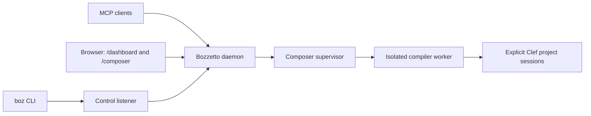

# Bozzetto

**Development coordination for the Fidelity Framework: one daemon, every client.**

Bozzetto connects editing, compiler evidence and running code across the people and agents working on a Clef project. It hosts explicit Composer project sessions in which edits are reserved before they are made, builds are differential (Composer recompiles what a change affects). MCP clients, the browser and command-line tools work through the same sessions and the same authority, and the browser shows the daemon's own facts as they settle: health, leases, the agents at work and, as the operations journal now in implementation lands, every caller's Composer operations.

[Architecture](docs/architecture.md) · [Composer workflow](docs/composer-workflow.md) · [Operations](docs/operations.md) · [Get started](#get-started) · [Documentation](docs/README.md)

## The Name

A *bozzetto* (Italian, pronounced bot-SET-oh) is the small model a sculptor shapes in clay or wax before starting the full work. The word is the diminutive of *bozzo*, "sketch" or "rough stone" ([Merriam-Webster](https://www.merriam-webster.com/dictionary/bozzetto), [Britannica](https://www.britannica.com/art/bozzetto)). A patron sees the bozzetto and asks for changes while a change still costs little.

The model gives an idea enough substance to be judged: proportion, movement and the relationship between parts become visible before the sculptor commits to the finished material. Bozzetto offers the same exchange between making and examining. A definition or a change is tried against a real project, its consequences are shown as compiler evidence and execution, and it is revised while the work is still open, with people and agents inspecting the same work.

The connection to **Atelier** is deliberate. An *atelier* is an artist's workshop, where sketches, models, tools and unfinished pieces are brought together. Atelier is Fidelity's editing and workbench environment: source beside compiler graphs, proof evidence, execution results and debugging views. Bozzetto is its companion, coordinating the shared compiler workspace and execution behind those views through Composer's contracts. Atelier is the place to arrange, edit and inspect the work; Bozzetto keeps the sessions and execution that people and agents rely on coordinated, so no single interface becomes the owner of compiler meaning.

<a id="-one-daemon-every-client"></a>
<a id="how-bozzetto-works"></a>

## How Bozzetto Works

One long-running daemon owns a single Composer supervisor. Every client reaches the same supervisor, which drives an isolated compiler worker holding the live project sessions. The daemon and its worker deploy as a matching pair, verified by the PSG contract fingerprint they share.



A project is opened explicitly from an absolute `.fidproj` path, and every operation carries the identity of its host, session and compiler epoch:

| Operation | Meaning |
|---|---|
| Open | Create a Composer project session for an explicit project. |
| Reserve | Withdraw the current artifact's run authority before source or dependency edits. |
| Build | Compile the reserved revision and return diagnostics and artifact evidence, region by region. |
| Run | Have Composer revalidate inputs and executable bytes, then execute the accepted native artifact. |
| Cancel, close or retire | Withdraw authority and report cleanup; replacing the compiler starts a fresh worker epoch. |

Status and artifact paths are evidence, not permission: execution always passes through Composer's revalidation.

### Three centerpieces

- **Fidelity.PSG** carries the compiler's semantic facts and their identities. Bozzetto presents them with their source, target and revision identity and never manufactures compiler meaning of its own.
- **Fidelity.FSharp.Incremental** is the shared foundation for dependency bookkeeping and explicitly started work, across Bozzetto and the Clef/CCS/Baker/Composer pipeline, and the bridge to self-hosting. Bozzetto keeps no separate invalidation mechanism; the daemon's own facts for the browser are derived on this foundation ([adoption contract](docs/Bozzetto_Incremental_Foundation_Adoption.md)).
- **Ranvier** is the reference shape for the reactive push plane: owners publish immutable values, derived views settle, effects deliver, within one mutation domain ([reactive push](docs/reactive-push.md)). It is a reference, not a dependency.

### Surfaces

- **MCP** (Streamable HTTP on port 47749): the `composer_*` tools, the lease tools, the cohort and agent-work tools, and the `composer://sessions` resource. MCP is JSON-RPC by external standard and is the one external boundary where JSON is a wire.
- **The browser** (`/dashboard` and `/composer` on 47749): one [Partas.Solid](https://github.com/shayanhabibi/Partas.Solid) bundle in [`bozzetto-web/`](bozzetto-web/README.md) over a single WebSocket bridge. The daemon pushes facts as their owners publish them, each stamped and carrying the age of what it shows; the page keeps the newest. Facts are typed on both sides from one shared vocabulary; the bridge's present text encoding is drift to remove, since direct interchange between daemon, worker, browser and agents is typed binary (BAREWire and typed contracts). JSON appears only as an export through Fidelity.Data and in the separate diagnostic sink process.
- **The control listener** (port 47750): daemon identity and shutdown for `boz status` and `boz stop`. It is a separate listener so that it answers even when the MCP listener has failed.

Builds and test suites over Clef and Composer code are Composer work: callers hold a lease for them, renewed while the work runs, and the leases show on the Composer page beside the compiler worker.

The host and compiler worker run on .NET. Their contracts are written so that native hosting can replace them without making CLR types, a particular editor or a transport the source of compiler authority. Bozzetto hosts no F# REPL; embedded F# session hosting is retired. Interactive Clef execution on LLVM ORC JIT is the intended Composer backend and is not implemented.

## Roles in Fidelity

| Component | Responsibility |
|---|---|
| Composer / Clef Compiler Service | Source snapshots, semantic and proof authority, compiler evidence, target-specific build and execution admission. |
| Bozzetto | Workspace and session ownership, worker lifecycle, client routing, leased work coordination, the agent cohort and its work board, and faithful observation. |
| Lattice | Language and proof tooling for editors, navigation and linked source/evidence views. |
| Atelier | A development environment presenting the same workspace through its own interaction and rendering choices. |

The [component contracts](docs/Bozzetto_Fidelity_Component_Contracts.md) set out the boundaries; the [architecture](docs/architecture.md) places the daemon, the worker, the native migration and the distributed lab-node requirements.

## Get Started

<a id="installation"></a>

### 1. Install

Bozzetto is built from source and published to the project's own Forgejo package registry; it is not published to NuGet.org. The daemon and its Composer worker are launched through the installed `boz` command, from a release directory that holds both as one matching pair. For host development, use the SDK pinned in `global.json` and follow [the contributing guide](CONTRIBUTING.md) and [development](docs/development.md); building the host does not change the compiler distribution a session runs.

### 2. Start the shared daemon

```bash
scripts/start-shared-daemon
```

The helper leaves an existing daemon in place. A new daemon runs from the dedicated workspace `${XDG_DATA_HOME:-$HOME/.local/share}/bozzetto/workspace` and logs to `${XDG_STATE_HOME:-$HOME/.local/state}/bozzetto/`, independent of any client's lifetime. Inspect it with bounded requests, never with a loop on its lifetime:

```bash
boz status
curl --fail --max-time 3 http://127.0.0.1:47749/health
```

### 3. Connect

| Interface | Address |
|---|---|
| Dashboard: health, machine resources, agents at work | `http://127.0.0.1:47749/dashboard` |
| Composer: worker, sessions, leases; every caller's operations and run output once the journal lands | `http://127.0.0.1:47749/composer` |
| Streamable HTTP MCP | `http://127.0.0.1:47749/` |
| Composer session resource | `composer://sessions` through MCP |
| Control listener | `http://127.0.0.1:47750/api/daemon-info` |

A connected agent exposes `composer_list_sessions` and `composer_open_project`; see [agents](docs/agents.md) and the [MCP reference](docs/mcp-tools.md).

### 4. Open, reserve, build and run

1. Open an absolute `.fidproj` from the Composer page or with `composer_open_project`.
2. Keep the returned host, session and compiler epoch for the operations that follow.
3. Reserve with `composer_reserve_edit` before changing source or dependencies.
4. Make the edit, then pass the reservation to `composer_build`.
5. Inspect the result and execute through `composer_run_current`.

### 5. Build and test the host under a lease

```bash
scripts/work-lease run full_build dotnet build
scripts/work-lease run test_suite_run dotnet <testDll> --summary
```

A lease is a heartbeat, not a deadline: the wrapper renews it while the command runs. Read the `TRUST` line a suite prints, not its exit code ([development](docs/development.md)).

## Repository Layout

| Path | Contents |
|---|---|
| `Bozzetto/` | Daemon, CLI, MCP server, control listener and the browser bridge with its fact plane. |
| `Bozzetto.Core/` | Shared engine, sessions, leases, cohort, persistence and protocol logic. |
| `Bozzetto.Composer/` | The Composer worker process. |
| `Bozzetto.Composer.Protocol/` | The typed binary daemon and worker contract. |
| `Bozzetto.Diagnostics/` | The separate diagnostic sink process. |
| `bozzetto-web/` | The Partas.Solid browser application and the shared bridge vocabulary. |
| `bozzetto-vscode/` | The VS Code extension. |
| `Bozzetto.Tests/`, `Bozzetto.Composer.Tests/` | Expecto suites. |
| `docs/` | The twelve documents of the [documentation index](docs/README.md). |
| `scripts/` | The shared daemon launcher and the lease wrapper. |

The [documentation index](docs/README.md) is the entry point: remit, the three centerpieces, and what is current versus planned. Dated checkpoints and audit receipts are evidence, kept outside the active documentation.

## Contributing

Read [CONTRIBUTING.md](CONTRIBUTING.md) and [AGENTS.md](AGENTS.md) for repository standards and workflows, and use the [architecture](docs/architecture.md) and [component contracts](docs/Bozzetto_Fidelity_Component_Contracts.md) to place new work. A proposed capability and its acceptance evidence are distinct; keep them so.

<a id="fork-status"></a>
<a id="hard-fork-lineage"></a>
<a id="acknowledgments"></a>

## Heritage and License

Bozzetto is a hard fork of [SageFs](https://github.com/WillEhrendreich/SageFs), Will Ehrendreich's live F# development daemon. Its persistent REPL, daemon architecture and hot reload engine supplied the working foundation: keep a project alive, try a change and see its effect through shared tools. [Fable.SageFs](https://github.com/shayanhabibi/Fable.SageFs), by Shayan Habibi, brought the Fable compiler into that live session and let its own transforms be revised from the REPL, an example that helped inspire Bozzetto's compiler workbench direction.

Bozzetto carries those ideas into Fidelity's compiler, device and workbench remit. [Upstream heritage](UPSTREAM_HERITAGE.md) records the fork history, original authorship and wider dependency credits.

[MIT license](LICENSE), with the original copyright notice preserved.
